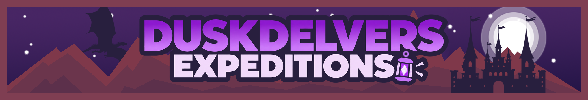

# Duskdelvers - Expeditions

<p align="center">
  
  
  
  
</p>

> **Beneath the kingdoms, darkness holds its own.**

Duskdelvers is an exploration mod for **Minecraft 1.21.1 / NeoForge**, being developed for the [Towns & Kingdoms 3 modpack](https://www.curseforge.com/minecraft/modpacks/towns-kingdoms-3). Its focus is the **Chaos Caverns**: an underground setting for repeatable expeditions, encounters and rewards.

## Project links

- [Project wiki](https://github.com/Mikaaah/Duskdelvers/wiki) · [Getting started](https://github.com/Mikaaah/Duskdelvers/wiki/Getting-Started) · [Current status](https://github.com/Mikaaah/Duskdelvers/wiki/Status)
- [Chaos Caverns](https://github.com/Mikaaah/Duskdelvers/wiki/Chaos-Caverns) · [Commands](https://github.com/Mikaaah/Duskdelvers/wiki/Commands) · [Troubleshooting](https://github.com/Mikaaah/Duskdelvers/wiki/Troubleshooting)
- [Roadmap](https://github.com/Mikaaah/Duskdelvers/wiki/Roadmap) · [Compatibility plans](https://github.com/Mikaaah/Duskdelvers/wiki/Compatibility)
- [Issues and feedback](https://github.com/Mikaaah/Duskdelvers/issues) · [Towns & Kingdoms 3 on CurseForge](https://www.curseforge.com/minecraft/modpacks/towns-kingdoms-3)

## Status

**In development.** The declared mod version remains `0.1.0-alpha`; no public Duskdelvers release is available. The source now includes an early 0.2 expedition implementation: planned room layouts and construction, tiered encounters, a final guardian and rewards, alongside the Delver's Compass and server settings.

This work is **not validated**. The latest GitHub Actions build for the current source commit failed, and complete in-game, dedicated-server and multiplayer testing has not been confirmed. Check the [wiki status page](https://github.com/Mikaaah/Duskdelvers/wiki/Status) and [Actions](https://github.com/Mikaaah/Duskdelvers/actions) before using a build. Keep experimental builds in a disposable test instance.

## Development setup

- Minecraft 1.21.1
- NeoForge 21.1.x
- Java 21

Build from the repository root:

```bash
gradle build --no-daemon
```

The current command interface includes `/duskdelvers enter`, `/duskdelvers start <1-5>`, `/duskdelvers exit` and `/duskdelvers status`. The Delver's Compass can select a tier and start or exit a run in source; these flows need validation.

## Planned optional integrations

Duskdelvers is being designed to work standalone. Optional integrations are planned separately and are not required dependencies.

- TNK Unidentified Loot — [CurseForge page pending approval](https://www.curseforge.com/minecraft/mc-mods/unidentified-loot-a-towns-kingdoms-mod)
- Resonant Arcana — [CurseForge page pending approval](https://www.curseforge.com/minecraft/mc-mods/resonant-arcana)

These are separate projects; their planned integration does not mean they are currently supported by Duskdelvers.

## Documentation

- [Architecture and current limitations](docs/ARCHITECTURE.md)
- [Development roadmap](docs/ROADMAP.md)
- [Compatibility plan](docs/COMPATIBILITY.md)
- [Branding guidelines](docs/BRANDING.md)

## License

All rights reserved unless the repository owner adopts an explicit license.
